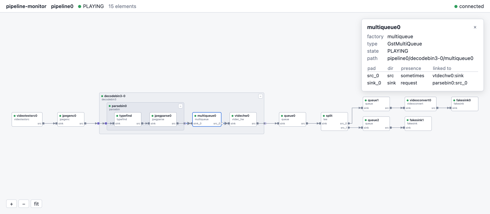

# pipeline-monitor

See a running GStreamer pipeline live in your browser.



pipeline-monitor is a GStreamer tracer plugin. Enable it with one environment
variable, without changing your application, and open http://127.0.0.1:8765/.

- Elements, pads and links as a graph, including nested bins and ghost pads
- Updates live as elements, pads, links and states change
- Errors and warnings from the pipeline: a counter, a log panel and badges on
  the elements that posted them; repeats are collapsed and noisy elements
  can be muted
- Negotiated caps on every pad and link: hover a pad or link, open the full
  caps in the element details, or show labels on all links
- Element details, collapsible bins, light and dark theme
- Local only: listens on 127.0.0.1 and loads nothing from the internet

## Build

Requires GStreamer 1.22 or newer, libsoup 3 and Meson.

On Ubuntu 24.04 or Debian 12:

```sh
sudo apt install meson ninja-build pkg-config libgstreamer1.0-dev \
  libsoup-3.0-dev libjson-glib-dev gstreamer1.0-plugins-base \
  gstreamer1.0-plugins-good gstreamer1.0-plugins-bad
```

On macOS with Homebrew:

```sh
brew install meson ninja pkgconf gstreamer libsoup json-glib
```

On Windows, install the official GStreamer MSVC package from
[gstreamer.freedesktop.org](https://gstreamer.freedesktop.org/download/)
with the development files, and Meson with `pip install meson ninja`. Then,
in a command prompt (adjust `GST` if you installed GStreamer elsewhere):

```bat
set GST=C:\Program Files\gstreamer\1.0\msvc_x86_64
set PATH=%GST%\bin;%PATH%
set PKG_CONFIG_PATH=%GST%\lib\pkgconfig
```

Then:

```sh
meson setup build
meson compile -C build
meson test -C build
```

On Windows, use `meson setup build --vsenv` so that Meson finds the Visual
Studio compiler.

## Use

```sh
GST_PLUGIN_PATH=$PWD/build/src GST_TRACERS=pipeline-monitor \
  gst-launch-1.0 videotestsrc is-live=true ! videoconvert ! autovideosink
```

On Windows:

```bat
set GST_PLUGIN_PATH=%CD%\build\src
set GST_TRACERS=pipeline-monitor
gst-launch-1.0 videotestsrc is-live=true ! videoconvert ! autovideosink
```

Then open the address it prints, by default http://127.0.0.1:8765/.

- In your own application, set `GST_TRACERS=pipeline-monitor` in the
  environment or with `setenv()` before `gst_init()`.
- Choose the port with `GST_TRACERS="pipeline-monitor(port=9000)"`. If the
  port is taken, the next free one is used.
- Errors and warnings are recorded by default;
  `GST_TRACERS="pipeline-monitor(log=false)"` turns that off (your application
  still receives them as usual). Options can be combined, e.g.
  `pipeline-monitor(port=9000,log=false)`.
- Try the example, which adds and removes a branch every two seconds:
  `./examples/run-example.sh --serve`; add `--warnings` to also see warnings
  (on Windows, run `build\examples\serve.exe` with `GST_PLUGIN_PATH` set as
  above)

The server has no authentication. It only accepts connections from the same
machine and only from its own page.

## Status

Version 0.2 shows the pipeline graph, errors and warnings, and the negotiated
caps. It is tested on macOS (Apple Silicon) with GStreamer 1.28.8, and in CI
on Ubuntu 24.04 (GStreamer 1.24), Debian 12 (GStreamer 1.22), macOS
(Homebrew) and Windows (official GStreamer 1.28.8, MSVC).

## License

LGPL-2.1-or-later, see [LICENSE](LICENSE).

A commercial license, support and GStreamer consulting are available from the
author, Łukasz Huńczak: lukasz.hunczak@imaginarybit.com,
[imaginarybit.com](https://imaginarybit.com)

The web page includes [elkjs](https://github.com/kieler/elkjs) for graph
layout, under the Eclipse Public License 2.0. See
[web/vendor/elkjs](web/vendor/elkjs).
