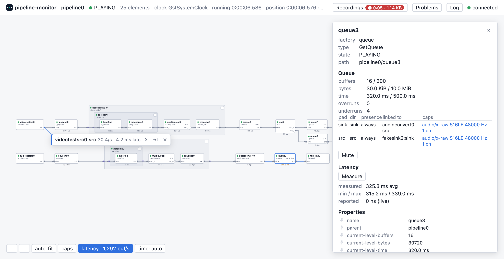
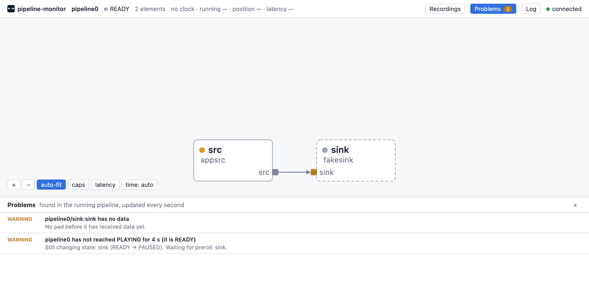

# Get started

pipeline-monitor shows a running GStreamer pipeline live in your browser:
its graph, problems, errors and warnings, queue levels, latency, the
values flowing through pads and the elements' properties. It is a
GStreamer tracer: your program needs no changes.

**Try it first, without installing:** open a demo recording in the
[viewer](../) on this site.



### Install

- **Ubuntu 24.04, Debian 12** (amd64, arm64): download the `.deb` from the
  latest release and `sudo apt install ./pipeline-monitor_*.deb`.
- **macOS with Homebrew:**
  `brew tap imgbit/tap`, `brew trust imgbit/tap` (Homebrew 7 and newer),
  `brew install pipeline-monitor`, then
  `export GST_PLUGIN_PATH="$(brew --prefix)/lib/gstreamer-1.0"`.
- **macOS with the official GStreamer.framework, Windows with the official
  MSVC package** (GStreamer 1.28 or newer): download the zip, unpack it,
  set `GST_PLUGIN_PATH` to its folder. The zips are not signed: on macOS
  run `xattr -d com.apple.quarantine libgstpipelinemonitor.dylib
  pipeline-monitor` in the folder; on Windows use `Unblock-File` or
  Properties → Unblock if the files are blocked.
- **Anything else:** build from source (see the README).

Check: `gst-inspect-1.0 pipeline-monitor` lists the tracer.

### Run

```sh
GST_TRACERS=pipeline-monitor gst-launch-1.0 videotestsrc ! autovideosink
```

(Windows: `set GST_TRACERS=pipeline-monitor`, then the command.) The
program prints an address, by default `http://127.0.0.1:8765/`. Open it.
For your own program, set `GST_TRACERS=pipeline-monitor` in its
environment, or with `setenv()` before `gst_init()`.

### Your first problem

Open **Problems** in the header. pipeline-monitor names what it finds in
plain words, for example "pipeline0 has not reached PLAYING for 4 s (it
is READY)", with the element it is about. Click the place to select the
element in the graph.



Next: [a tour of the page](tour.html).
