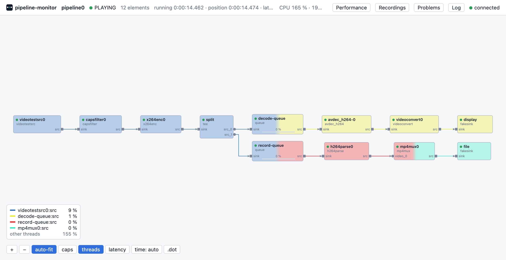
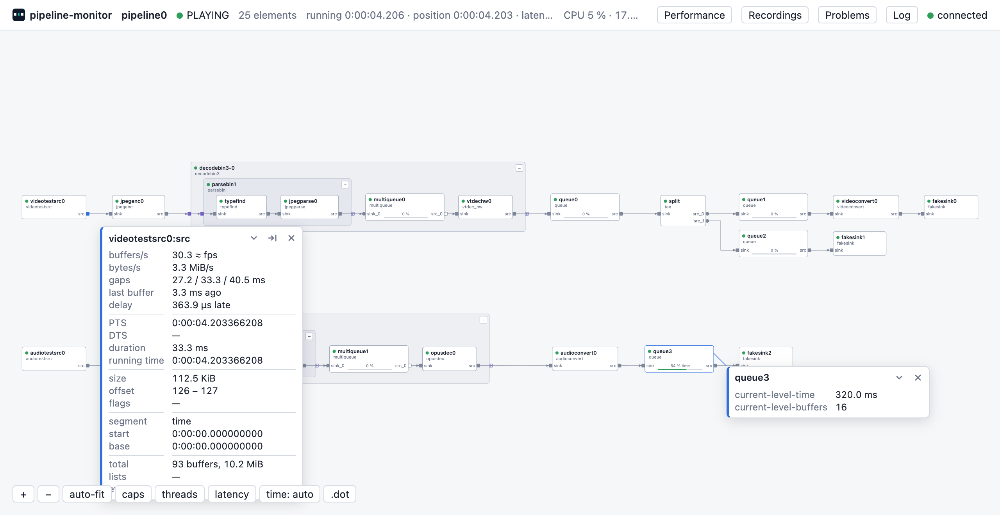
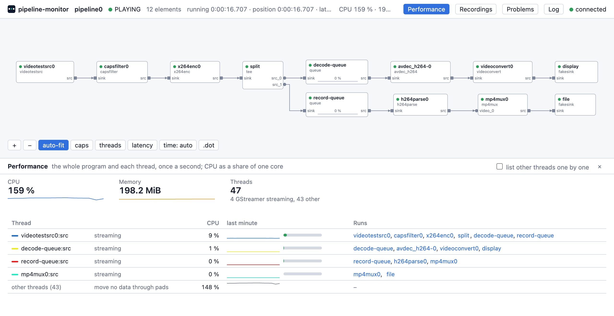
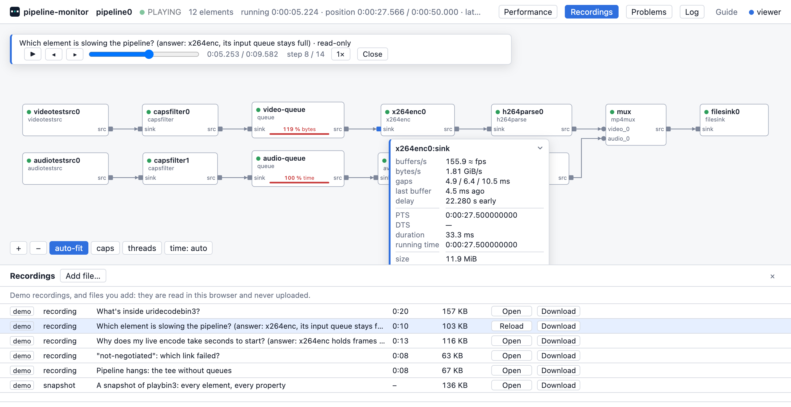

# Tour

- **Header:** the pipeline and its state, the number of elements, its
  running time, position and latency (its clock in the tooltip), the whole
  program's CPU and memory; the buttons **Performance**, **Recordings**,
  **Problems** and **Log** with their counts, and the connection.
- **Graph:** every element and bin with its pads and links. Click a bin's
  corner to collapse it. Zoom with the wheel or + and −; **auto-fit**
  keeps it fitted. **caps** shows the caps on every link; hover a link or
  a pad for its caps and details. Queues and multiqueues show their level
  on each pad's row: how full, and the limit it is nearest (bytes, time or
  buffers). **.dot** saves GStreamer's own `.dot` of the pipeline shown.
- **Threads:** **threads** colours every element and link by the thread
  that runs it. A queue starts a thread, so it shows two colours: the one
  that brings data in and its own. The legend lists the threads with their
  CPU; hover an element for its threads by name.

- **Details:** click an element: its factory, state and path, a queue's
  level, its pads and what they link to, its errors and warnings, its
  latency, and all its properties (live when pinned).
- **appsrc and appsink:** their details add their own queue and the
  segment each sends or receives. **Data from appsink** names the appsink
  that feeds an appsrc, found from the data, with the same buffer at both
  ends: PTS, segment, running time, each pipeline's clock and base time,
  and when each plays it. When the program copies the data, choose an
  appsink to compare with.
- **Explanations:** what is underlined with dots has one: hover it, or tap
  it on a phone.

- **Pinned pads:** click a pad to pin it: a card with buffers per second,
  gaps, the last buffer's age and timestamps, its delay against the
  clock. Fold, move or close the card.
- **Pictures and levels:** pin a pad of raw video for a small picture of
  it once a second, with its brightness, black frames, and how long the
  picture has stayed exactly the same (a frozen source or a stuck
  decoder). Pin a pad of raw audio for a level meter of its first two
  channels: peak and RMS in dBFS, clipped samples and silence. Both are
  live only: recordings do not keep them.
- **Pinned properties:** in the details, pin a property: a card with its
  value, live; counters show their rate.
- **Latency:** **Measure** in an element's details, or **latency** under
  the graph for every element: how long data takes through it, with the
  latency it reports.
- **Performance:** the program's CPU and memory over the last minute, and
  each GStreamer thread: its CPU (100 % is one core kept busy) and the
  elements it runs; click one to select it. Other threads (an element's
  own helpers, such as an encoder's, and the program's) are added up, or
  listed one by one. In a recording, the moment shown and the minute
  before it.

- **Problems:** what pipeline-monitor finds: data that stopped and where,
  pipelines not reaching their state, sinks with no data, full queues,
  formats that do not match, late sinks, a thread that uses a whole core
  where the pipeline must keep up, elements still alive after leaving
  their pipeline. Each names its element.
- **Log:** the program's errors and warnings, per element; mute an
  element's.
- **Recordings:** **Record** saves everything the page shows over time,
  **Snapshot** one moment. Files you can play back here, or send with a
  bug report. **Add file…** opens one from your computer, or a GStreamer
  `.dot` file.

- **Viewer:** a recording opens read-only at its start, with ▶, the speed
  and a slider to any moment. ◂ and ▸ (or the arrow keys) step from one
  recorded moment to the next; click the time or the step to type where to
  go. Where the recording has no pipeline, the page says when it appears and
  takes you there. Its pins show the recorded values.
- **A .dot file:** a pipeline graph your program dumped
  (`GST_DEBUG_DUMP_DOT_DIR`), drawn like a live pipeline, with states, caps
  and properties; where a link failed, what each side accepts. It is one
  moment without live data, so Performance, Problems and Log are hidden.
  Element factories are looked up from the type, and say so.
- **When the program ends or is killed:** the page keeps the last state
  and connects again by itself when the program runs again.
