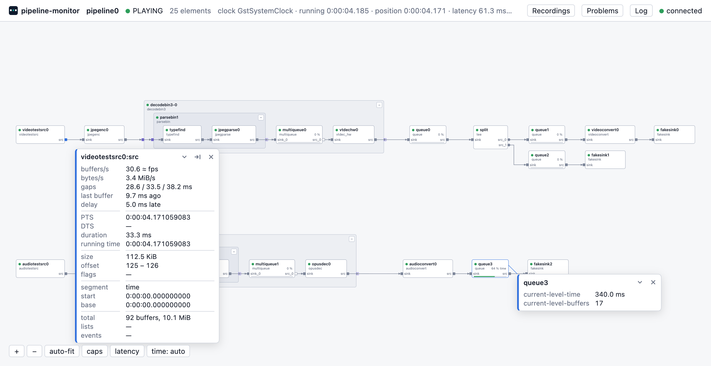
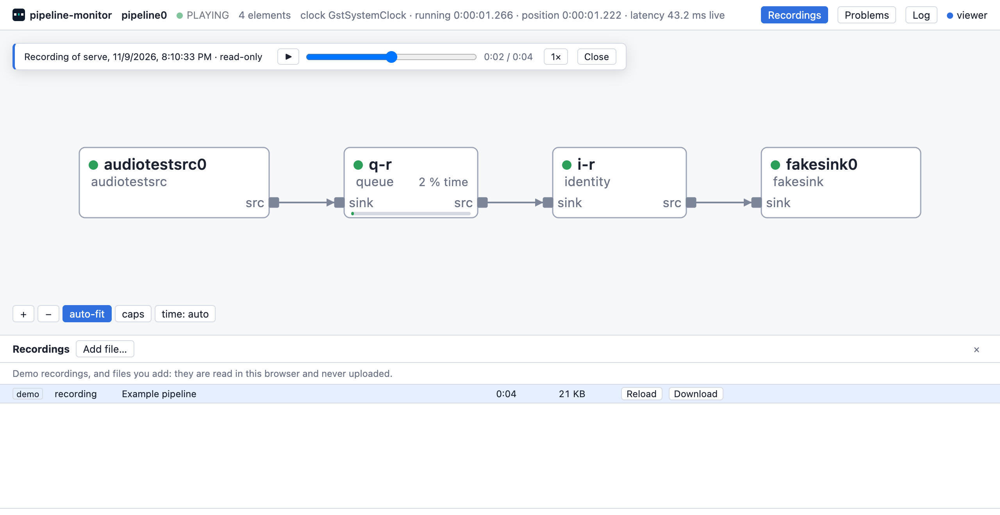

# Tour

- **Header:** the pipeline and its state, the number of elements, its
  clock, running time, position and latency; the buttons **Recordings**,
  **Problems** and **Log** with their counts, and the connection.
- **Graph:** every element and bin with its pads and links. Click a bin's
  corner to collapse it. Zoom with the wheel or + and −; **auto-fit**
  keeps it fitted. **caps** shows the caps on every link; hover a link or
  a pad for its caps and details.
- **Details:** click an element: its factory, state and path, a queue's
  level, its pads and what they link to, its errors and warnings, its
  latency, and all its properties (live when pinned).

- **Pinned pads:** click a pad to pin it: a card with buffers per second,
  gaps, the last buffer's age and timestamps, its delay against the
  clock. Fold, move or close the card.
- **Pinned properties:** in the details, pin a property: a card with its
  value, live; counters show their rate.
- **Latency:** **Measure** in an element's details, or **latency** under
  the graph for every element: how long data takes through it, with the
  latency it reports.
- **Problems:** what pipeline-monitor finds: data that stopped and where,
  pipelines not reaching their state, sinks with no data, full queues,
  formats that do not match, late sinks. Each names its element.
- **Log:** the program's errors and warnings, per element; mute an
  element's.
- **Recordings:** **Record** saves everything the page shows over time,
  **Snapshot** one moment. Files you can play back here, or send with a
  bug report. **Add file…** opens one from your computer.

- **Viewer:** a recording opens read-only, with ▶, the speed and a
  slider to any moment; its pins show the recorded values.
- **When the program ends or is killed:** the page keeps the last state
  and connects again by itself when the program runs again.
